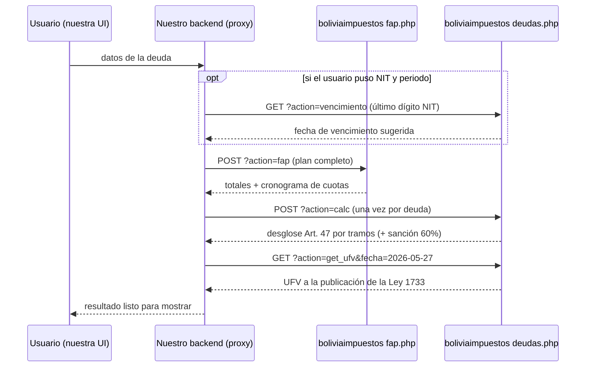
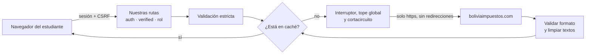

# Calculadora "Deuda con Alivio Tributario (al contado o FAP)": análisis de boliviaimpuestos.com

Página analizada: <https://boliviaimpuestos.com/maletin/fap-alivio.php>
Fecha del análisis: 15/11/2026, hecho con Playwright MCP: lectura del JavaScript de la página, captura del tráfico y llamadas de prueba a su API.

**Objetivo acordado:** nuestro sistema va a **usar su misma API**. Si ellos cambian el cálculo, el nuestro cambia con ellos. Este documento describe esa API (el contrato), explica cómo calcula cada número y señala los riesgos de depender de ella.

---

## 1. Resumen en 6 puntos

1. **Todo el cálculo ocurre en su servidor**, en dos archivos PHP: `fap.php` y `deudas.php`. El JavaScript de la página solo envía los datos y dibuja la respuesta. No se puede "leer su PHP": lo que hicimos fue deducir las fórmulas a partir de lo que entra y lo que sale.
2. Las fórmulas deducidas se comprobaron con un script propio contra sus respuestas reales: **700 de 700 valores coinciden al centavo** (ver [verificar-formulas.cjs](verificar-formulas.cjs)).
3. **Su API sí se puede usar desde nuestro servidor**: responde HTTP 200 en ~1 s, sin cookies, sin clave y sin desafío de Cloudflare (probado el 15/11/2026).
4. **No se puede llamar desde el navegador de nuestros usuarios**: no envía cabeceras CORS. La llamada tiene que pasar por nuestro backend, que actúa de intermediario (proxy).
5. Es una **API interna, sin documentar y sin contrato**. Pueden cambiar nombres de campos, bloquear servidores externos o apagarla sin aviso. "Si ellos cambian, nosotros también" funciona para cambios en el cálculo, pero **un cambio de formato rompe nuestra pantalla**. Por eso proponemos un monitor diario (sección 7).
6. Encontramos **4 errores o comportamientos dudosos** en su lógica (sección 6). Si usamos su API, los heredamos.

---

## 2. Cómo se arma un cálculo (flujo)



Su página hace exactamente estas llamadas: `fap` para el plan, `calc` para la "memoria de cálculo" y `get_ufv` para el dato de la UFV a la publicación de la ley.

---

## 3. Contrato de la API (lo que hay que enviar y lo que vuelve)

Base: `https://boliviaimpuestos.com/maletin/`. Todas las respuestas son JSON. Si algo falla, viene `"error": "mensaje"`; si todo sale bien, `"error": false`.

### 3.1 `POST fap.php?action=fap`: plan completo (el endpoint principal)

**Envío** (`Content-Type: application/json`):

```json
{
  "fechaSolicitud": "2026-11-15",
  "mesPrimera": 2,
  "tipoGarantia": "efectivo",
  "modo": "regularizacion",
  "deudas": [
    { "impuesto": "IVA", "periodo": "2019-01", "fechaVenc": "2019-02-15",
      "tributoOmitido": 10000, "cuotas": 12 }
  ]
}
```

| Campo | Valores | Qué hace |
|---|---|---|
| `fechaSolicitud` | `AAAA-MM-DD` | Fecha a la que se calcula la deuda. Puede ser pasada o futura. |
| `mesPrimera` | entero (la página usa `2`) | La 1.ª cuota vence el último día hábil del mes *solicitud + N*. |
| `tipoGarantia` | `efectivo` \| `hipotecaria` | Efectivo: garantía del 5%. Hipotecaria: 0% en efectivo. |
| `modo` | `regularizacion` | **Con alivio (Ley 1733)**, tope de 36 cuotas. Cualquier otro valor activa el **FAP normal sin alivio** (responde `modo: "fap"`, tope de 30 cuotas, sin condonación). |
| `deudas[].impuesto` | `IVA`, `IT`, `IUE`, `RC-IVA`, `Otro` | Solo es una etiqueta: no cambia el cálculo. |
| `deudas[].periodo` | `AAAA-MM` | **Decide si la deuda se condona** (ver 4.6). |
| `deudas[].fechaVenc` | `AAAA-MM-DD` | Fecha desde la que corren el mantenimiento de valor y el interés. |
| `deudas[].tributoOmitido` | número en Bs | Capital adeudado. |
| `deudas[].cuotas` | entero | Cuotas pedidas. El servidor lo baja al máximo permitido. |

**Respuesta** (valores del caso de la captura):

| Campo | Ejemplo | Significado |
|---|---|---|
| `totalNormal` | 21400.77 | Deuda sin alivio: tributo + mantenimiento de valor + interés Art. 47 (sin sanción). |
| `totalContado` | 12352.15 | **Al contado con alivio**: tributo + 50% del mantenimiento de valor. |
| `totalConsolidado` | 14185.57 | **Base del FAP con alivio**: tributo actualizado a la UFV del día de publicación de la ley. |
| `ahorroTotal` | 7215.20 | `totalNormal − totalConsolidado` |
| `totalCondonado`, `nCondonadas`, `nRegularizables` | 0, 0, 1 | Deudas perdonadas al 100% y deudas que entran al plan. |
| `pagoInicial`, `porcentajePagoInicial` | 709.28, 5 | 5% de la base FAP. |
| `garantia`, `porcentajeGarantia` | 709.28, 5 | 5% si es en efectivo; 0 si es hipotecaria. |
| `saldoTotal` | 12767.01 | Base − pago inicial − garantía. |
| `maxCuotas` | 12 | Cuotas con las que **realmente** se calculó el plan. |
| `maxCuotasPermitidas`, `topeCuotas` | 18, 36 | Máximo según la cuota mínima de 200 UFV, y tope legal. |
| `cuotaMinimaUFV`, `cuotaMinimaBs` | 200, 674.94 | 200 UFV a la UFV de la solicitud. |
| `ufvSolicitud` | 3.37471 | UFV de la fecha de solicitud (proyectada si es futura). |
| `pubLey` | `2026-05-27` | Fecha de publicación de la Ley 1733 (fija en su servidor). |
| `inflacionAnualEstim` | 12.53 | Variación de la UFV en los últimos 12 meses, en %. |
| `ufvUltimaFecha` | `2026-12-10` | Último día con UFV oficial del BCB. Desde ahí la UFV se proyecta. |
| `hoy` | `2026-11-15` | Fecha del servidor de ellos. |
| `nVencidas`/`totalVencido`, `nPorVenir`/`totalPorVenir` | | Cuotas que ya vencieron y cuotas por venir (cuando la solicitud es una fecha pasada). |
| `avisos[]` | | Textos listos para mostrar, por ejemplo "se ajustó de 36 a 13 cuotas…". |
| `deudas[]` | | Desglose por deuda: `tratamiento` (`regularizable` \| `condonado` \| `normal`), `mv`, `interes`, `totalNormal`, `total` (base FAP), `contado`, `pagoInicial`, `garantia`, `saldo`, `cuotas`, `maxCuotasDeuda`. |
| `cronograma[]` | | Una fila por cuota: `n`, `fecha`, `ufv`, `proyectada` (UFV estimada), `vencida`, `totalCuota`, `compTO` (capital), `compMV` (mantenimiento de valor), `compInt` (interés), `minBs`, `bajoMinimo`, `deudasActivas` y `detalle[]` por deuda. |

### 3.2 `POST deudas.php?action=calc`: deuda de una obligación (memoria de cálculo)

```json
{ "fechaVenc": "2019-02-15", "fechaPago": "2026-11-15", "tributoOmitido": 10000,
  "impuesto": "IVA", "periodo": "2019-01", "sancionOmision": false, "precisionFactor": "completa" }
```

Devuelve `ufvVenc`, `ufvPago`, `cUFV` (tributo en UFV), `toActualizadoBs`, `mvBs`, `interesUFV`, `interesBs`, `deudaBs`, `sancionBs` (solo si `sancionOmision: true`), `diasMora` y `tramos[]` (`tasa`, `pct`, `dias`, `desde`, `hasta`, `factor`, `interesUFV`).

### 3.3 `GET deudas.php?action=vencimiento&periodo=2019-01&impuesto=IVA&nit=2`

Devuelve `{"fecha":"2019-02-15"}`, o `{"fecha":null}` para `Otro` o un periodo mal formado. **Solo recibe el último dígito del NIT**, así que no viaja el NIT completo.

### 3.4 `GET deudas.php?action=get_ufv&fecha=2026-05-27`

Devuelve `{"ufv":3.25566}`, o `{"ufv":null}` si la fecha es posterior a la última UFV publicada.

> La página también llama a `comentarios.php?action=list&tool=fap-alivio`, que solo trae los comentarios de los visitantes. No lo necesitamos.

---

## 4. Cómo calcula cada número (fórmulas verificadas)

Caso de la captura: IVA del periodo 2019-01, vencimiento 15/02/2019, tributo omitido Bs 10.000 y solicitud el 15/11/2026.

| UFV | Fecha | Valor |
|---|---|---|
| UFV al vencimiento | 15/02/2019 | 2,29505 |
| UFV a la solicitud | 15/11/2026 | 3,37471 |
| UFV a la publicación de la Ley 1733 | 27/05/2026 | 3,25566 |

### 4.1 Deuda sin alivio (Art. 47 del Código Tributario)

| Paso | Fórmula | Resultado |
|---|---|---|
| Tributo en UFV (c) | `TO ÷ UFVvenc`, redondeado a 5 decimales | 4.357,20355 UFV |
| Tributo actualizado | `c × UFVsolicitud` | Bs 14.704,30 |
| Mantenimiento de valor (MV) | `actualizado − TO` | Bs 4.704,30 |
| Interés, tramo 4% | primeros 4 años (1.461 días): `c × [(1 + 0,04/360)^días − 1]` | 767,92 UFV |
| Interés, tramo 6% | años 5 a 7 (1.096 días), con la misma fórmula | 873,17 UFV |
| Interés, tramo 10% | desde el año 8 (273 días) | 343,22 UFV |
| Interés total | `Σ tramos × UFVsolicitud` | Bs 6.696,47 |
| **Deuda total** | `TO + MV + interés` | **Bs 21.400,77** |
| Sanción por omisión (opcional) | `60% × c × UFVsolicitud`, solo si es una determinación (casilla marcada) | Bs 8.822,58 |

**Detalle importante:** cada tramo se calcula **sobre el mismo capital `c`** y los tramos se suman. El interés de un tramo no genera interés en el siguiente.

### 4.2 Al contado con alivio

`totalContado = TO + 50% × MV a la fecha de solicitud = 10.000 + 2.352,15 = **Bs 12.352,15**`
Se condonan el interés, la otra mitad del mantenimiento de valor y la sanción.

### 4.3 En cuotas (FAP con alivio)

| Paso | Fórmula | Resultado |
|---|---|---|
| Base FAP | `c × UFVpublicación`: el mantenimiento de valor se **congela** al 27/05/2026 | Bs 14.185,57 |
| Pago inicial | `5% × base` | Bs 709,28 |
| Garantía | `5% × base` en efectivo; `0` si es hipotecaria | Bs 709,28 |
| Saldo | `base − inicial − garantía` | Bs 12.767,01 |
| Cuota mínima | `200 UFV × UFVsolicitud` | Bs 674,94 |
| Máximo de cuotas | `min(36, piso(saldo ÷ cuota mínima))` | 18 |
| Capital por cuota | `saldo ÷ n.º de cuotas` (12) | Bs 1.063,92 |

### 4.4 Cada cuota del cronograma

Para la cuota con fecha `F` y UFV `U(F)`:

```
capUFV   = capital ÷ UFVpublicación
MV       = capUFV × U(F) − capital
interés  = capUFV × U(F) × [(1 + 0,04/360)^días(27/05/2026 → F) − 1]
cuota    = capital + MV + interés
```

Ejemplo, cuota 1 (29/01/2027, UFV proyectada 3,44472, 247 días):
`1.063,92 + 61,78 + 31,32 = **Bs 1.157,02**`

- El **interés de facilidades es del 4% anual** y corre **desde la publicación de la ley**, no desde la solicitud. Esto se verificó con solicitudes en julio de 2026, noviembre de 2026 y marzo de 2027.
- Las fechas de las cuotas caen en el **último día hábil de cada mes** y respetan los feriados bolivianos: Carnaval, Viernes Santo, Corpus Christi y fines de semana.
- Con **varias deudas**, cada una arma su propio plan (base, 5% inicial, 5% de garantía y saldo ÷ cuotas) y el cronograma suma todas las cuotas de un mismo mes. La cuota mínima de 200 UFV se mide contra el **saldo total sumado**, no deuda por deuda.

### 4.5 UFV futura (proyección)

Pasado el último dato oficial (`ufvUltimaFecha`), la UFV se estima así:

```
i        = UFV(última) ÷ UFV(última − 12 meses) − 1          → 12,53 %
por día  = (1 + i)^(1/12 ÷ días del mes calendario)
U(F)     = UFV(última) × producto de los factores diarios hasta F
```

Por eso, las cuotas marcadas **"est."** son aproximadas. El SIN fija el monto real el día del pago.

### 4.6 Qué deudas se condonan al 100%

La regla depende **solo del periodo**. El impuesto y el monto no influyen. Se probaron 5 impuestos × 20 fechas, más montos desde Bs 100 hasta Bs 100.000.

| Periodo | Tratamiento |
|---|---|
| hasta **2017-12** | **condonado**: no paga nada |
| 2018-01 a 2019-12 | regularizable (contado o FAP con alivio) |
| **2020-01 a 2020-12** | **condonado** |
| desde 2021-01 | regularizable |

Si el `periodo` viene vacío, la regla se aplica sobre la fecha de vencimiento.

### 4.7 Vencimiento sugerido por NIT

- **IVA, IT y RC-IVA:** día `13 + último dígito del NIT` del mes siguiente al periodo. Si cae en feriado o fin de semana, pasa al siguiente día hábil (ejemplo: Carnaval de 2026 → 18/02).
- **IUE:** `cierre de gestión + 120 días`, pasado al siguiente día hábil (diciembre → 30/04, marzo → 29/07, junio → 28/10, septiembre → 28/01). Tienen al menos una excepción cargada a mano: la gestión 2019 vence el 31/07/2020 por la prórroga de la pandemia.

### 4.8 Lo que calcula la página, no el servidor

Si armamos nuestra propia pantalla, estos valores los calculamos nosotros a partir de la respuesta:

| En pantalla | Fórmula |
|---|---|
| "Ahorras hasta" | `totalNormal − totalContado` (Bs 9.048,62) |
| "Mant. valor congelado" | `totalConsolidado − Σ tributo omitido` |
| Cuota mensual ≈ | promedio de `cronograma[].totalCuota` |
| Total final con FAP | `pagoInicial + garantia + Σ totalCuota` (Bs 16.371,89) |
| Sobrecosto del FAP | `(total final − totalContado) ÷ totalContado` (+32,5%) |
| "Monto adeudado actual" con sanción | `deudaBs + sancionBs` de `deudas.php?action=calc` con `sancionOmision: true` |

---

## 5. ¿Se puede usar su API desde nuestro sistema? Sí, con un intermediario

Pruebas del 15/11/2026:

| Prueba | Resultado |
|---|---|
| `POST fap.php` desde un servidor, sin cookies y con un User-Agent genérico | ✅ HTTP 200, JSON correcto, ~1,1 s |
| `GET get_ufv` con el User-Agent por defecto de curl | ✅ HTTP 200 |
| Llamada desde el navegador desde otro dominio (CORS) | ❌ no envían `Access-Control-Allow-Origin`, así que el navegador la bloquea |
| Clave o autenticación | No piden ninguna |

**Conclusión:** nuestro frontend llama a **nuestro backend**, y es nuestro backend el que llama a boliviaimpuestos. Esto además nos permite controlar el tiempo de espera, guardar en caché y no exponer su API en nuestra pantalla.

---

## 6. Errores y comportamientos dudosos de su lógica (los heredamos si usamos su API)

| # | Qué pasa | Evidencia | Qué haríamos nosotros |
|---|---|---|---|
| 1 | **La barra de cuotas no coincide con el plan.** La barra arranca en 12; el servidor responde que el máximo es 18 y la página mueve la barra a 18 **sin recalcular**. Se ve en la captura original: la barra dice 18 y el plan dice 12 cuotas. | Código de su página, función `calc()` | Mostrar siempre `maxCuotas` de la respuesta, nunca el valor de la barra. |
| 2 | **Acepta deudas que vencen después de publicada la ley.** Con vencimiento el 15/06/2026, la base del FAP sale **menor que el tributo omitido** (Bs 9.932,85 < Bs 10.000): un mantenimiento de valor negativo. | [02-variantes.json](capturas/02-variantes.json) → `post_pub` | Validar en nuestro backend que la deuda sea anterior a la ley, o confirmar el alcance con un tributarista. |
| 3 | **La última cuota no se ajusta.** 12 × 1.063,92 = 12.767,04, pero el saldo real es 12.767,01: se cobran 3 centavos de más. | [01-caso-base.json](capturas/01-caso-base.json) | Menor. Se puede corregir ajustando la última cuota. |
| 4 | **Errores confusos.** Un tributo negativo responde "UFV no disponible". | [03-vencimientos-y-varias-deudas.json](capturas/03-vencimientos-y-varias-deudas.json) → `bad2` | Validar las entradas en nuestro lado antes de llamar. |

**Para confirmar con un tributarista** (no son errores comprobados, pero sostienen todos los números):

- El interés del Art. 47 por tramos **sin capitalizar** entre tramos (4.1).
- El interés de facilidades del 4% contado **desde la publicación** de la ley (4.4).
- Las ventanas de condonación (≤ 2017 y año 2020) (4.6).

No revisamos estos puntos contra el texto de la Ley 1733 ni contra su reglamento, porque el objetivo es reflejar lo que hace boliviaimpuestos.

---

## 7. Riesgos de depender de su API y cómo cubrirlos

| Riesgo | Cómo cubrirlo |
|---|---|
| **Es una API interna, sin documentar y sin permiso de uso.** Pueden bloquear nuestro servidor (con una regla de Cloudflare o un límite de llamadas) o cambiarla sin aviso. | **Pedir permiso o un acuerdo a boliviaimpuestos** antes de salir a producción. Es la única protección real. |
| **Un cambio de formato** (campos renombrados o quitados) rompe nuestra pantalla sin dar error visible. | **Monitor diario:** un job programado envía el caso base y verifica que estén los campos de la sección 3. Si falta alguno, avisa. Los JSON de `capturas/` sirven de referencia. |
| **Un cambio en el cálculo** (que es lo que queremos reflejar) pasa sin que nadie lo note. | El mismo monitor compara los números con [01-caso-base.json](capturas/01-caso-base.json). Si cambian, avisa para revisar qué ajustaron. ⚠ Los valores cambian solos cuando se publica una UFV nueva o pasa el día, así que la comparación debe usar una fecha de solicitud fija ya pasada. |
| **Caída o lentitud** (~1 s por llamada; una pantalla con varias deudas hace 2 + N llamadas). | Tiempo de espera de unos 10 s, un reintento y un mensaje claro: "Calculadora no disponible por el momento". Caché larga para `get_ufv` de fechas pasadas y para `vencimiento`, que nunca cambian. **No cachear `fap`**: depende de la fecha de hoy y de la UFV proyectada. |
| **Datos del cliente que salen a un tercero** (montos, periodos, último dígito del NIT; nada de nombres ni el NIT completo). | Mencionarlo en nuestros términos y privacidad. Nunca enviar más campos de los que pide su API. |

**Plan B:** si nos bloquean, las fórmulas de la sección 4 están verificadas al centavo y se pueden pasar a PHP en nuestro sistema. Para eso necesitaríamos nuestra propia tabla de UFV, tomada del BCB.

---

## 8. Archivos de esta carpeta

| Archivo | Para qué sirve |
|---|---|
| [probar-api.php](probar-api.php) | **Prueba de su API desde PHP**, como la haría nuestro backend: 15 casos, revisión del contrato, CORS y velocidad. Devuelve código 0 si todo pasa y 1 si algo falla, así que sirve también como monitor diario. Comando de Docker en el encabezado del archivo. Resultado del 15/11/2026: ✅ todo OK, ~0,4 s por llamada. |
| [verificar-formulas.cjs](verificar-formulas.cjs) | Reimplementación independiente de las fórmulas. Ejecutar `node verificar-formulas.cjs` → 700/700 coinciden. |
| [capturas/01-caso-base.json](capturas/01-caso-base.json) | Respuestas reales del caso de la captura (12 y 18 cuotas, garantía hipotecaria, `calc` con y sin sanción, UFV). |
| [capturas/02-variantes.json](capturas/02-variantes.json) | Deuda de 2010, deuda posterior a la ley, montos chicos y grandes, modo normal, solicitud pasada, varias deudas. |
| [capturas/03-vencimientos-y-varias-deudas.json](capturas/03-vencimientos-y-varias-deudas.json) | Vencimientos por NIT e IUE, 3 deudas en 36 cuotas, garantía hipotecaria, errores. |
| [capturas/04-condonacion-grilla.json](capturas/04-condonacion-grilla.json), [05-condonacion-limites.json](capturas/05-condonacion-limites.json) | Pruebas que fijan las ventanas de condonación. |

---

## 9. Cómo quedó en el sistema (módulo `TaxRelief`)

La pantalla es para estudiantes: **Calculadora tributaria** en el menú "Principal", en `/herramientas/alivio-tributario`.



| Pieza | Dónde |
|---|---|
| Rutas, controlador y validaciones | `app/Modules/TaxRelief/` (`Routes`, `Controllers`, `Requests`) |
| Llamadas hacia afuera y protecciones | `app/Modules/TaxRelief/Services/BoliviaImpuestosClient.php` |
| Traducción de su formato al nuestro, y caché | `app/Modules/TaxRelief/Services/TaxReliefService.php` |
| Revisión diaria (07:00 de Bolivia, avisa al desarrollador líder) | `app/Modules/TaxRelief/Console/CheckUpstreamCommand.php` |
| Configuración (todo tiene valor por defecto) | `config/tax_relief.php` |
| Pantalla | `resources/js/components/tax-relief/` y `resources/views/tax-relief/index.blade.php` |
| Pruebas (36) | `tests/Feature/TaxRelief/` (no llaman al servicio real) |

**Seguridad y límites:**

| Qué | Cómo |
|---|---|
| Quién entra | Sesión iniciada, correo verificado y rol Estudiante (`User`), Coordinador, Administrador o Superadministrador. |
| Cuánto puede calcular cada persona | 10 por minuto y 150 por día; 20 búsquedas de vencimiento por minuto. |
| Cuánto llamamos a boliviaimpuestos en total | Máximo 30 por minuto y 400 por hora entre todos. Los cálculos repetidos salen del caché hasta fin del día y no cuentan. |
| Si su servicio falla | Después de 5 fallas seguidas se deja de llamarlo 5 minutos (cortacircuito) y el estudiante ve "no disponible". |
| Lo que sale | Solo campos de una lista blanca: nunca se reenvía la petición del navegador. Del NIT solo viaja el último dígito. |
| Lo que entra | Se valida tipo por tipo. Si el formato cambió, no se muestra nada a medias. Los textos se limpian de HTML y la respuesta tiene un tamaño máximo. |
| Conexión | Solo https, sin seguir redirecciones, con 10 s de tiempo máximo. La URL la fija la configuración, nunca el usuario. |
| Apagado de emergencia | `TAX_RELIEF_ENABLED=false` oculta el menú y apaga los cálculos sin desplegar código. |

**Variables opcionales del `.env`:** `TAX_RELIEF_ENABLED`, `TAX_RELIEF_API_URL`, `TAX_RELIEF_TIMEOUT`, `TAX_RELIEF_USER_PER_MINUTE`, `TAX_RELIEF_USER_PER_DAY`, `TAX_RELIEF_UPSTREAM_PER_MINUTE`, `TAX_RELIEF_UPSTREAM_PER_HOUR`, `TAX_RELIEF_ALERT_EMAIL` y `TAX_RELIEF_CHECK_AT`.

---

## 10. Revisión diaria y aviso al desarrollador líder

Todos los días a las **07:00 (hora de Bolivia)** el sistema ejecuta `php artisan tax-relief:check`. El comando prueba los 3 servicios de boliviaimpuestos que usa la pantalla, con un caso de referencia de fecha fija:

| Prueba | Valor esperado |
|---|---|
| Plan (`fap.php`) | Sin alivio Bs 21.400,77, al contado Bs 12.352,15, en cuotas Bs 14.185,57, 12 cuotas |
| Desglose (`deudas.php?action=calc`) | Mantenimiento de valor Bs 4.704,30, interés Bs 6.696,47, tramos de 1461, 1096 y 273 días |
| Vencimiento (`deudas.php?action=vencimiento`) | IVA 2019-01 con NIT terminado en 2 vence el 15/02/2019 |

| Resultado | Qué pasa |
|---|---|
| Todo igual | No se envía nada (queda `tax_relief.monitor_ok` en el log). |
| Responde, pero con otros valores | Correo **"cambió el cálculo"**, con qué cambió. No es un error: la calculadora ya muestra los valores nuevos. |
| Algún servicio falla o cambió su formato | Correo **"dejó de funcionar"**, con qué falló y qué hacer. El comando termina con error. |
| Mucho uso en ese momento (tope global) | No se prueba; se reintenta al día siguiente. |

### Cómo activarlo en Hostinger

1. **Correo del desarrollador líder** en el `.env` del servidor: `TAX_RELIEF_ALERT_EMAIL=lider@dominio.com`. Para varios, separarlos con comas. Si queda vacío, el aviso solo queda en el log.
2. **Correo saliente (SMTP).** Es el mismo mailer de Laravel que ya envía los correos de verificación de cuenta. En hPanel → Correos se crea una cuenta, por ejemplo `avisos@dominio.com`, y se usa en el `.env`:

   ```dotenv
   MAIL_MAILER=smtp
   MAIL_HOST=smtp.hostinger.com
   MAIL_PORT=465
   MAIL_SCHEME=smtps
   MAIL_USERNAME=avisos@dominio.com
   MAIL_PASSWORD=********
   MAIL_FROM_ADDRESS=avisos@dominio.com
   ```

3. **Cron de Laravel** en hPanel → Avanzado → Cron Jobs, cada minuto. Es una sola línea y sirve para todas las tareas programadas, incluidos los respaldos de la rama de seguridad:

   ```
   * * * * * cd /home/USUARIO/ruta-del-proyecto && php artisan schedule:run >> /dev/null 2>&1
   ```

4. **Probar** desde la terminal del servidor:
   - `php artisan tax-relief:check --test-mail` envía un correo de prueba al líder, para confirmar que el SMTP funciona.
   - `php artisan tax-relief:check --no-mail` ejecuta las 3 pruebas y muestra el resultado sin enviar correo.
   - `php artisan schedule:list` debe mostrar `tax-relief:check` con su próxima ejecución.
